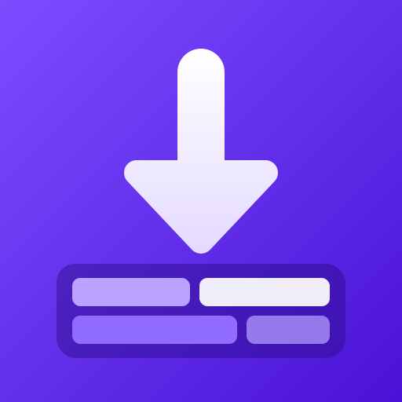

# Beutl.Extensions.YtDlp

[yt-dlp](https://github.com/yt-dlp/yt-dlp) を使って動画・音声をダウンロードし、Beutl のタイムラインに追加する拡張機能です。



UI は Beutl の表示言語に合わせて、日本語、英語、簡体字中国語、韓国語、スペイン語で表示されます。言語は Beutl の「設定」→「表示」→「言語」で選び、Beutl を再起動すると反映されます。

## 機能

- **Beutl のブラウザーからダウンロード**。YouTube などの視聴ページから、動画ごとに形式・画質と保存先を選んでダウンロードできます。
- **ツールタブ「yt-dlp」**（「検索」「履歴」の 2 画面）
  - 検索欄に**キーワード**を入れると YouTube / SoundCloud / ニコニコ動画 / Bilibili を検索し、サムネイル・タイトル・長さ・再生回数など、取得できた情報を一覧に表示します。件数は設定で変更できます（既定 20 件）。ニコニコ動画は公式のスナップショット検索 API を使用するため、最新の投稿が検索結果に反映されるまで時間がかかる場合があります。Bilibili は動画ごとに情報を取得するため、ほかのサイトより検索に時間がかかります。
  - 検索欄で **Enter** を押すと検索します。**URL** を入れると検索欄のアイコンが 🔍 から 🔗 に変わり、その動画を同じ行形式で 1 件表示します（`www.youtube.com/...` のようなスキーム無しの入力も可）。URL 入力は検索先の選択に関係なく、[yt-dlp の対応サイト](https://github.com/yt-dlp/yt-dlp/blob/master/supportedsites.md)の動画に利用できます。
  - 各行の **⬇** ボタン（または行のダブルクリック）で保存先（設定した保存先、未設定ならプロジェクトの `resources/yt-dlp/`）にダウンロード、**📚** ボタンで Beutl の素材フォルダー（`~/.beutl/materials/yt-dlp/`）にダウンロードします。ダウンロード中は行の中に進捗（%、サイズ、速度、残り時間）が出て、⬇ がキャンセル（✕）に変わります。完了は ✓ 付きの状態文字、失敗は赤い状態文字で分かります。
  - 各行の **形式**（「形式: 最高画質 ▾」）はその行がどの形式でダウンロードされるかを示します。クリックするとその動画の利用可能フォーマットを取得して個別に選べ、選ぶと「この動画: 1080p mp4」のようにアクセント色で表示されます。
  - ツールバーの **⚙** に共通設定をまとめています: 形式プリセット（最高画質（H.264 / MP4 優先）、1080p まで、720p まで、音声のみ（M4A）、カスタム引数）、カスタム引数、保存先、ダウンロード後にタイムラインへ追加。
  - 各行の 🌐 で動画ページをブラウザーで開けます。
  - ダウンロード完了後、再生ヘッドの位置に要素を追加します（映像 + 音声はグループ化され、空いているレイヤーに配置されます）。
  - 「履歴」画面では、ダウンロードしたファイルを再度タイムラインに追加したり、保存先フォルダーを開けます。履歴はファイルに直接保存されるのでタブを閉じても残ります。素材フォルダーへの履歴は `~/.beutl/yt-dlp-history.json`（すべてのプロジェクトで共有）、保存先への履歴はシーンと同じ場所の `.beutl/yt-dlp-history.json` です。「履歴から削除」はファイルを残したまま履歴だけを消します。
  - ツールバー右端の **⋮** から yt-dlp の更新とログの表示。
- **yt-dlp の自動インストール / 更新**: GitHub Releases から最新の展開済み（unpackaged）ビルドの zip を `~/.beutl/yt-dlp/` にダウンロード・展開し、SHA-256 で検証します。単一ファイル版は起動のたびに自己展開して数秒かかるため使いません。
- **設定**（Beutl の設定 → 拡張機能）: yt-dlp の実行ファイル、FFmpeg の場所、既定の保存先、既定の形式、すべての呼び出しに付加する追加引数、検索結果の件数

## 動作要件

- ブラウザーメニュー連携を含む Beutl 本体の開発版（`BrowserDownloadExtension.TryDownloadPageAsync` 対応）
- FFmpeg（映像と音声の結合と、音声の m4a への変換に使います。YouTube の動画は多くが映像と音声に分かれて提供されるため、実質的に必須です。Beutl がインストールしたもの（Windows・Linux は `~/.beutl/ffmpeg`、macOS は Homebrew の `ffmpeg@8`）と PATH 上のものから、実際に起動できるものを自動検出します）
- yt-dlp は拡張機能からインストールできます。既に PATH 上にある場合はそれを使います。

## 利用上の注意

- この拡張機能は yt-dlp を呼び出すだけのフロントエンドです。ダウンロードするコンテンツの著作権と、各サイトの利用規約は、利用者ご自身の責任で確認してください。
- 権利者の許諾がないコンテンツや、サイトの利用規約でダウンロードが認められていないコンテンツはダウンロードしないでください。違法にアップロードされたものと知りながら著作物をダウンロードすることは、日本の著作権法で禁止されています。
- ダウンロードした素材を動画に使う場合も、権利者の許諾やライセンスの条件に従ってください。
- yt-dlp（[The Unlicense](https://github.com/yt-dlp/yt-dlp/blob/master/LICENSE)）はこの拡張機能に同梱していません。インストールを選んだときに GitHub の公式リリースから取得します。FFmpeg も同梱していません。

## 使い方

Beutl のブラウザーで視聴ページを開き、ブラウザーメニューの **「メディアをダウンロード」** を選びます。動画情報の取得後にダイアログが開きます。画質プリセットや動画が提供する形式、保存先（設定済みのフォルダー・素材フォルダー・任意のフォルダー）、タイムラインへの追加を選び、**「ダウンロード」** で開始します。選択は今回のダウンロードにだけ適用され、進捗は yt-dlp タブに表示されます。

キーワードや URL を直接入力する場合は、yt-dlp タブから検索できます。

1. Beutl でシーンを開き、ツールタブの追加メニューから **yt-dlp** を開きます。
2. yt-dlp が見つからない場合はタブ内の **インストール** を押します（`~/.beutl/yt-dlp/` に保存されます）。
3. 検索欄にキーワードまたは URL を入力して Enter を押します。
4. 必要なら ⚙ で形式プリセットを、行の形式で動画ごとのフォーマットを選び、行の **⬇** を押します。「ダウンロード後にタイムラインへ追加」が有効なら完了後にタイムラインへ追加されます。

保存先が空の場合、プロジェクトフォルダーの `resources/yt-dlp/` に保存されます。

## 開発

### Beutl パッケージについて

SDK は公開版の `2.0.0-preview.13` を使います。ブラウザーメニューの API は開発版のため、初回はこの変更を含む Beutl 本体で参照パッケージを作成します。

```bash
./build.sh nuget-pack --version 2.0.0-preview.13.browser-download.1 --assembly-version 2.0.0.0
```

本体が隣の `../beutl` にある場合は、この拡張のルートで以下を実行します。

```bash
dotnet restore Beutl.Extensions.YtDlp.slnx -p:RestoreAdditionalProjectSources="$PWD/../beutl/artifacts"
```

### ビルド・テスト

```bash
dotnet build Beutl.Extensions.YtDlp.slnx
dotnet test Beutl.Extensions.YtDlp.slnx
```

### Beutl で試す（サイドロード）

`DebugApplication=true` を付けてビルドすると `~/.beutl/sideloads/Beutl.Extensions.YtDlp/` に出力され、
次回起動時に Beutl が読み込みを確認します。

```bash
dotnet build src/Beutl.Extensions.YtDlp -c Debug -p:DebugApplication=true
```

ブラウザーメニューを試すには、メニュー連携の変更を含む Beutl 本体のルートで `./build.sh dev` を実行し、シーンを開きます。

### 公開手順

1. `src/Beutl.Extensions.YtDlp/Beutl.Extensions.YtDlp.csproj` の `Version` と `AssemblyVersion`、`PackageReleaseNotes` を更新し、[CHANGELOG.md](CHANGELOG.md) に変更点を追記します。
2. テストを通してからパッケージを作成します。`src/Beutl.Extensions.YtDlp/bin/Release/Beutl.Extensions.YtDlp.<version>.nupkg` ができます。

   ```bash
   dotnet test Beutl.Extensions.YtDlp.slnx
   dotnet pack src/Beutl.Extensions.YtDlp -c Release
   ```

3. ブラウザーメニューの API を含む Beutl が公開されたら、そのバージョンのパッケージを参照してビルドします。[Beutl のデベロッパーページ](https://beutl.beditor.net/ja/developer)でリリースを作成し、対応バージョン（targetVersion）に本体のバージョンを指定して `.nupkg` をアップロードします。
4. ストアの掲載情報は [docs/store-listing.md](docs/store-listing.md)、アイコンは [assets/icon.png](assets/icon.png) を使います。

## License

[MIT](LICENSE)
